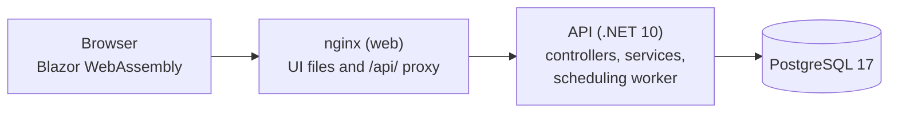
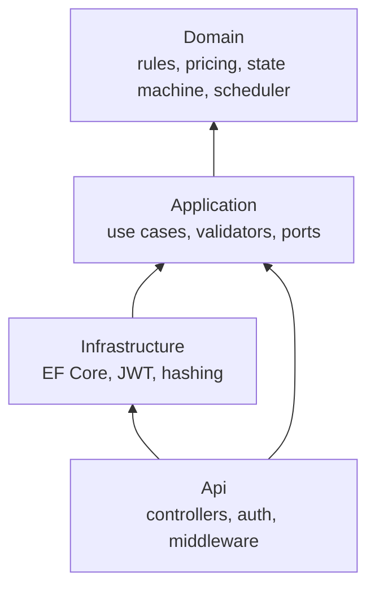

# FuelFlow

An order and delivery system for a Danish heating oil and diesel supplier. Customers order fuel, dispatchers confirm and plan deliveries, and a background scheduler puts each order into the earliest truck run that has room.

It is a portfolio project, and also a way to learn C#/.NET coming from Java and Spring Boot. The code is meant to be read: business rules live in a small, dependency-free Domain layer and are covered by tests.

**.NET 10** · ASP.NET Core Web API · EF Core + PostgreSQL 17 · JWT auth · Blazor WebAssembly · Docker · GitHub Actions

## What it does

- **Customers** (private or business) register, manage delivery addresses, get a price quote, place orders, follow them and cancel them.
- **Dispatchers** see all orders, filter by status, region and date, confirm them, send them out and record the delivered litres.
- **Admins** can also change product prices. Prices are kept as history, so old orders never change.
- **The scheduler** assigns confirmed orders to delivery windows (one truck, one region, one day), oldest first, never the same day, never overbooking, even with several API copies running.
- Prices follow the rules of the business: minimum order, small-order fee, business volume discount, 25 percent VAT, and the right display (private customers see VAT included, business customers see it excluded).

## Architecture at a glance





Dependencies only point inward. The full picture (request pipeline, class diagrams, database tables, swimlane and sequence diagrams) is in **[docs/](docs/README.md)**.

## Documentation

| | |
|---|---|
| [Architecture](docs/architecture.md) | Layers, runtime picture, request pipeline, configuration |
| [Domain model](docs/domain-model.md) | Class diagrams and database tables |
| [Business rules](docs/business-rules.md) | Pricing, order life cycle, scheduling, validation, with worked examples |
| [Flows](docs/flows.md) | Swimlane of a whole order and key sequence diagrams |
| [API reference](docs/api-reference.md) | Endpoints, roles, errors |
| [Design decisions](docs/design-decisions.md) | The why, the trade-offs, known shortcuts and limitations |
| [Testing and delivery](docs/testing-and-delivery.md) | Test strategy, CI, CD, images |

## Tech stack

| Area | Choice |
|---|---|
| Runtime | .NET 10 (LTS), C#, nullable reference types, warnings as errors |
| API | ASP.NET Core Web API with controllers, built-in OpenAPI, Scalar docs in Development |
| Data | EF Core with Npgsql, PostgreSQL 17, migrations, `xmin` optimistic concurrency |
| Auth | JWT bearer, roles, ASP.NET Core `PasswordHasher` (no full Identity) |
| Validation and errors | FluentValidation, RFC 7807 ProblemDetails through one global handler |
| UI | Blazor WebAssembly (standalone), plain CSS, served by nginx |
| Tests | xUnit v3, Shouldly, NSubstitute, bUnit, Testcontainers (real PostgreSQL), `FakeTimeProvider` |
| Build | Central package management, `dotnet format` gate, coverage with coverlet |
| Delivery | Docker (chiseled non-root API image), Docker Compose, GitHub Actions, Trivy, GHCR, Dependabot |

Deliberately **not** used: MediatR, AutoMapper and FluentAssertions (commercial licenses, and not needed here).

## Run it locally

You need the .NET 10 SDK and either Podman or Docker.

### Everything in containers (recommended)

```bash
podman compose up --build        # or: docker compose up --build
```

| What | Address |
|---|---|
| Web UI | <http://localhost:8081> |
| API and Scalar docs | <http://localhost:8080/scalar> |
| PostgreSQL | `localhost:5432` (user, password and database `fuelflow`, dev only) |

In this mode the API runs in `Development`: it applies migrations and loads demo data by itself. Demo accounts (passwords are in `src/FuelFlow.Api/appsettings.Development.json`, dev only, never in the image):

| Account | Role |
|---|---|
| `admin@fuelflow.local` | Admin |
| `dispatcher@fuelflow.local` | Dispatcher |
| `anna@example.com` | Private customer, one address in Copenhagen |
| `jensen@example.com` | Business customer, one address in Aarhus |

The demo data also has three products with prices and delivery windows for the next 14 days in Copenhagen and Aarhus.

### API only, from source

```bash
podman compose up -d postgres
dotnet run --project src/FuelFlow.Api
```

The API listens on <http://localhost:5044> (Scalar at `/scalar`). The UI needs nginx in front, so use the compose stack for it.

### Required settings outside Development

The API refuses to start without them (fail fast):

| Environment variable | Meaning |
|---|---|
| `ConnectionStrings__Default` | PostgreSQL connection string |
| `Jwt__SigningKey` | Secret of at least 32 bytes |

Everything else has a default. The full list (pricing numbers, regions, scheduler interval, rate limit) is in [Architecture](docs/architecture.md#5-configuration-reference).

## Run the tests

```bash
dotnet test
```

384 tests: 172 Domain, 65 Application, 48 Web, 99 integration. The integration tests start PostgreSQL with Testcontainers, so they need a container engine. With Podman, enable its Docker-compatible socket once:

```bash
systemctl --user enable --now podman.socket
export DOCKER_HOST=unix://$XDG_RUNTIME_DIR/podman/podman.sock
```

More in [Testing and delivery](docs/testing-and-delivery.md).

### Database migrations

```bash
dotnet tool restore
dotnet ef migrations add <Name> --project src/FuelFlow.Infrastructure --output-dir Persistence/Migrations
```

## The business rules in one table

| Topic | Rule |
|---|---|
| Minimum order | 500 litres, and never more than the address's tank capacity |
| Small order fee | 250 DKK excl. VAT under 1,000 litres |
| Business discount | 2 percent from 5,000 litres (business customers only) |
| VAT | 25 percent. Private customers see totals incl. VAT, business customers excl. VAT. The API returns both. |
| Rounding | 2 decimals, half away from zero, all in `PriceCalculator` |
| Order life cycle | Pending, Confirmed, Scheduled, OutForDelivery, Delivered. Cancel until it is out for delivery. Anything else is a 409. |
| Delivery | Delivered litres within plus or minus 10 percent of ordered. Final price recalculated from the order-time snapshot. |
| Scheduling | Oldest order first, earliest window in the order's region with room, never the same day |
| Prices | Append-only history with "valid from". Orders keep their price snapshot. |
| Data privacy | Another customer's order or address is a 404, never a 403 |

Worked examples and the exact rounding rules are in [Business rules](docs/business-rules.md).

## CI/CD

- **CI** (`ci.yml`, on pull requests and pushes to main): format check, Release build with warnings as errors, unit tests, integration tests against PostgreSQL, coverage summary.
- **CD** (`cd.yml`): after CI passes on `main`, and on version tags (`v1.2.3`): build the API and web images, scan both with Trivy (fails on CRITICAL), push to GitHub Container Registry tagged with the commit SHA, and with the version and `latest` on tags. Each job has minimal permissions and uses `GITHUB_TOKEN`.
- **Dependabot** updates NuGet packages, Docker base images and GitHub Actions weekly.

Diagrams and details in [Testing and delivery](docs/testing-and-delivery.md#2-continuous-integration-ciyml).

## Design decisions and trade-offs

The main ones, in a sentence each (all explained in [Design decisions](docs/design-decisions.md)):

- **Layers with the Domain in the middle**, so the important rules are testable in milliseconds.
- **PostgreSQL `xmin` for optimistic concurrency**: parallel bookings cannot overbook a window, and the loser gets a clean 409.
- **A pure scheduler** (plan in memory, then apply each assignment on its own), run by a thin background worker on every replica.
- **Real PostgreSQL in the tests**, because the interesting behaviour (concurrency, constraints) only exists there.
- **Everything is configuration, nothing is hidden state**: stateless API, environment variables, logs to stdout, health probes. Ready for Kubernetes.

### Where the login token lives (security trade-off)

The JWT is kept in memory and copied to **sessionStorage**, so a page reload keeps you logged in; closing the tab logs you out.

The catch: any JavaScript running on the page can read sessionStorage, so a cross-site scripting (XSS) bug could steal the token. Blazor escapes everything it renders and the app never writes raw HTML, which is the main defence, and tokens expire after 60 minutes (there are no refresh tokens).

Alternatives and why they were not chosen: an httpOnly cookie hides the token from scripts but needs CSRF protection and a proxy that holds the session (the "backend for frontend" pattern), which is more moving parts than this project wants. Keeping the token only in memory is safer but logs you out on every reload.

Possible hardening later: a Content-Security-Policy header (Blazor's import map is an inline script, so it needs a hash or nonce first) and a backend-for-frontend.

The UI reads the role from the token to decide which pages to show. That is convenience, not security: the API checks the signed token on every request.

## Known limitations

- No UI yet for creating delivery windows or changing prices (use the API). Without windows, confirmed orders wait; the worker logs a warning.
- An order larger than any single window can never be scheduled.
- No Content-Security-Policy, no end-to-end browser test in CI, no Kubernetes manifests yet.

The full list with ideas for each is in [Design decisions](docs/design-decisions.md#known-limitations-and-next-steps).

## Project layout

```
src/
  FuelFlow.Domain/          entities, value objects, PriceCalculator, order state machine, DeliveryScheduler
  FuelFlow.Application/     use case services, validators, DTOs, repository interfaces
  FuelFlow.Infrastructure/  EF Core, migrations, repositories, JWT, password hashing, dev seeding
  FuelFlow.Api/             controllers, auth, middleware, health checks, scheduling worker, Dockerfile
  FuelFlow.Web/             Blazor WebAssembly UI, nginx config, Dockerfile
tests/
  FuelFlow.Domain.UnitTests/
  FuelFlow.Application.UnitTests/
  FuelFlow.Web.UnitTests/
  FuelFlow.Api.IntegrationTests/
docs/                       architecture, domain model, business rules, flows, API, decisions
.github/workflows/          ci.yml, cd.yml, dependabot.yml
docker-compose.yml          postgres, api, web
```

## For Java developers: how things map

| Spring Boot | Here |
|---|---|
| `@RestController`, `@ControllerAdvice` | `[ApiController]` classes, `GlobalExceptionHandler` |
| `@Service`, constructor injection | Services with primary constructors, `IServiceCollection` registration |
| Spring Data JPA, `@Version` | EF Core (`DbContext`), `xmin` concurrency token |
| `application.yml`, profiles | `appsettings.json`, `appsettings.Development.json`, environment variables |
| Bean Validation | FluentValidation |
| Spring Security, JWT filter | JWT bearer middleware, `[Authorize(Roles = ...)]` |
| `@Scheduled` | `BackgroundService` with `PeriodicTimer` |
| `Clock` | `TimeProvider` |
| Testcontainers, `@SpringBootTest` | Testcontainers, `WebApplicationFactory` |
| Maven `dependencyManagement`, parent POM | `Directory.Packages.props`, `Directory.Build.props` |
