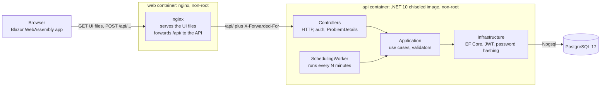
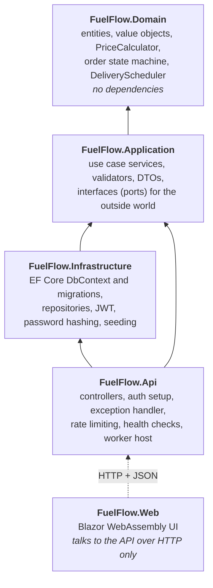
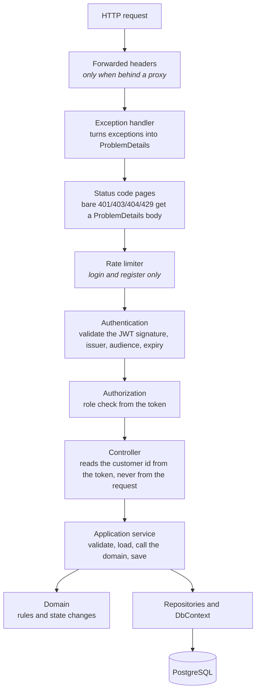

# Architecture

FuelFlow is a layered .NET 10 backend with a Blazor WebAssembly UI. This page shows how the pieces fit together and why they are split this way.

## 1. The system at runtime

Things worth knowing:

- The browser only talks to **one address** (nginx). nginx serves the UI and forwards `/api/` to the API, so the UI needs no CORS settings.
- The API is **stateless**. Every request is checked from its JWT. Any number of API copies can run behind a load balancer.
- The **scheduling worker lives inside the API process**. Every copy runs it. The database concurrency checks make that safe (see [flows](flows.md#3-two-replicas-schedule-at-the-same-time)).
- Everything is configured with environment variables. Logs go to stdout. Both are what Kubernetes expects, and a Kubernetes deployment is the planned next step.

## 2. Layers and the dependency rule

Dependencies only point **inward**. The Domain knows nothing about the database, HTTP or any framework.

| Project | What lives there | Spring equivalent |
|---|---|---|
| `FuelFlow.Domain` | Entities, value objects (`CvrNumber`, `PostalCode`), `PriceCalculator`, `Order` state machine, `DeliveryScheduler`, `RegionMap` | Plain domain model, no `@Entity` annotations |
| `FuelFlow.Application` | `AuthService`, `OrderService`, `DispatchService`, `SchedulingService`, FluentValidation validators, repository interfaces | `@Service` classes and repository interfaces |
| `FuelFlow.Infrastructure` | `FuelFlowDbContext`, entity configurations, migrations, repository implementations, `JwtTokenService`, `PasswordService`, dev seeder | Spring Data / JPA, security config |
| `FuelFlow.Api` | Controllers, `GlobalExceptionHandler`, rate limiter, `SchedulingWorker`, `Program.cs` wiring | `@RestController`, `@ControllerAdvice`, `@SpringBootApplication` |
| `FuelFlow.Web` | Pages, `ApiClient`, `AuthSession`, CSS | A separate front-end app |

**Why the interfaces sit in Application, not Infrastructure:** the use cases *need* "a place to find users" but should not know it is PostgreSQL. Application defines `IUserRepository`; Infrastructure implements it. This is the "ports and adapters" idea. It also makes the services unit-testable with mocks.

The class diagrams are in [domain-model.md](domain-model.md).

## 3. What happens to one request

Errors take the reverse way: a domain rule throws an exception, the exception handler maps it to a status code. The mapping table is in [api-reference.md](api-reference.md#error-responses).

## 4. Cross-cutting rules

| Rule | How it is done |
|---|---|
| Time | `TimeProvider` is injected everywhere. No `DateTime.Now`. All times are UTC `DateTimeOffset`. Tests use a controllable clock. |
| Money | `decimal` only, two decimals, `MidpointRounding.AwayFromZero`. All calculation is in one class, `PriceCalculator`. |
| Errors | RFC 7807 ProblemDetails for every error, including 401, 403, 404 and 429. |
| Validation | FluentValidation for input shape (field-by-field errors). Domain methods enforce the business rules again, so the rules hold no matter who calls them. |
| Other people's data | Looked up by `(id, customerId)`. A foreign id simply "does not exist" and returns 404, so existence is never leaked. |
| Concurrency | PostgreSQL `xmin` as an optimistic concurrency token on `orders` and `delivery_windows`. A lost race returns 409. |
| Configuration | Environment variables override everything. The app refuses to start without a valid connection string, JWT key (at least 32 bytes) and region setup. |
| Secrets | Dev credentials only in `appsettings.Development.json`. That file is removed from the Docker image. |

## 5. Configuration reference

| Setting (environment variable form) | Purpose | Default |
|---|---|---|
| `ConnectionStrings__Default` | PostgreSQL connection | none, required |
| `Jwt__SigningKey` | HMAC key for tokens, at least 32 bytes | none, required |
| `Jwt__Issuer`, `Jwt__Audience`, `Jwt__ExpiryMinutes` | Token settings | `fuelflow`, `fuelflow`, `60` |
| `Pricing__MinimumOrderLitres` and the other `Pricing__*` keys | Business numbers, see [business rules](business-rules.md) | 500, 1000, 250, 5000, 0.02, 0.25 |
| `Delivery__Regions__0__Name`, `__From`, `__To`, ... | Postal code ranges per region | six regions covering all of Denmark |
| `Scheduling__IntervalMinutes` | How often the worker runs. `0` turns it off. | `5` |
| `RateLimiting__AuthPermitLimit` | Login and register attempts per minute per client address | `10` |
| `ASPNETCORE_FORWARDEDHEADERS_ENABLED` | Trust `X-Forwarded-For` from the proxy in front. Only set when the API is not reachable directly. | off |
| `ASPNETCORE_ENVIRONMENT` | `Development` also migrates the database and loads demo data | `Production` |

## 6. Health checks

- `GET /health/live` answers 200 if the process is running. It checks nothing else.
- `GET /health/ready` also checks the database. It returns 503 while PostgreSQL is unreachable.

These are meant for Kubernetes liveness and readiness probes.
