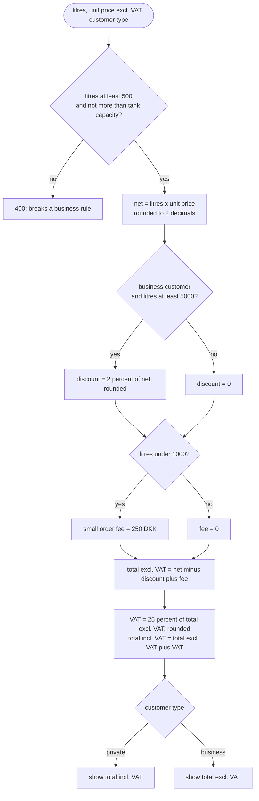
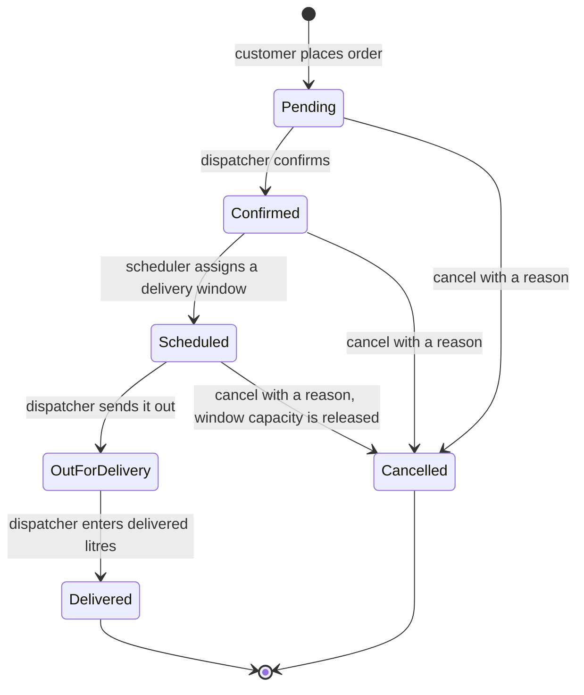
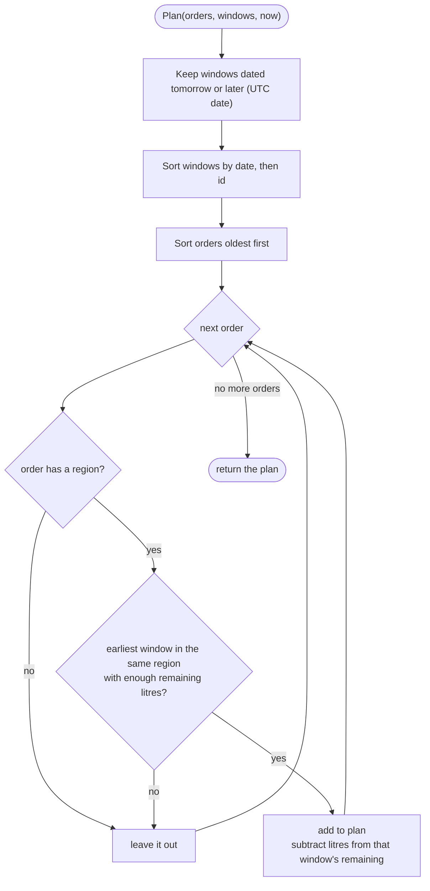

# Business rules

Every rule below is enforced in code and covered by tests. The numbers in **bold** are defaults from configuration (`Pricing__*`, see [architecture](architecture.md#5-configuration-reference)).

## 1. Roles

| Role | Can do |
|---|---|
| **Customer** | Register, manage own profile and delivery addresses, get quotes, place orders, see and cancel own orders |
| **Dispatcher** | See all orders, confirm, send out for delivery, mark delivered, create and list delivery windows |
| **Admin** | Everything a dispatcher can, plus change product prices |
| Anonymous | See the public price list, register, log in |

Customers can only ever see their own data. Asking for another customer's order or address returns **404**, not 403, so nobody can find out which ids exist.

## 2. Customers and addresses

| Rule | Detail |
|---|---|
| Customer types | **Private** needs a full name. **Business** needs a company name and a valid CVR. |
| CVR | Exactly 8 digits and it must pass the Danish modulus-11 check (weights 2, 7, 6, 5, 4, 3, 2, 1, sum divisible by 11). Example valid number: `10150817`. |
| Email | Also the login name. Stored in lower case. Unique. Cannot be changed in the UI. |
| Password | 8 to 128 characters. Stored hashed (ASP.NET Core `PasswordHasher`, PBKDF2 with salt). |
| Postal code | 4 digits, 1000 to 9999. |
| Tank capacity | Litres, greater than zero. An order can never exceed it. |
| Address changes | Street, postal code and city are **frozen once the address has orders**, because orders point at the address and the delivery location must not change under them. Notes and tank capacity can still change. Create a new address instead. |
| Address deletion | Not allowed (409) when the address has orders. |

## 3. Prices

### Price history

- Each product has a **price per litre excluding VAT**.
- A price change is a **new row with a "valid from" time**. Past prices are never overwritten.
- A change can be scheduled for the future. A scheduled price that has **not yet taken effect** can be replaced by a new change (to fix a typo). A price already in force is never touched.
- A price cannot be set in the past.

### How an order is priced

All rounding is to **2 decimals, half away from zero** (`0.005` becomes `0.01`). .NET rounds half to even by default, so this is set explicitly.

The API always returns **both** totals plus a `displayIncVat` flag; the UI highlights the right one.

### Boundaries and worked examples

Unit price 10.00 DKK per litre unless stated.

| Case | Calculation | Result |
|---|---|---|
| Private, 1000 L | net 10,000.00. No fee (1000 is not under 1000). VAT 2,500.00 | **12,500.00** incl. VAT |
| Private, 999 L | net 9,990.00, fee 250.00, ex VAT 10,240.00, VAT 2,560.00 | **12,800.00** incl. VAT |
| Private, 500 L (minimum) | net 5,000.00, fee 250.00, ex VAT 5,250.00, VAT 1,312.50 | **6,562.50** incl. VAT |
| Private, 499 L | rejected | 400, minimum order is 500 litres |
| Business, 4,999 L | net 49,990.00, no discount | **49,990.00** excl. VAT |
| Business, 5,000 L | net 50,000.00, discount 1,000.00, ex VAT 49,000.00, VAT 12,250.00 | **49,000.00** excl. VAT (61,250.00 incl.) |
| Private, 5,000 L | no discount for private customers | 62,500.00 incl. VAT |
| Rounding | 1001 L at 0.005 = 5.005 | 5.01 (not 5.00) |

## 3b. Delivered litres: the final price

When an order is delivered, the dispatcher enters the litres actually delivered.

- The delivered litres may differ from the ordered litres by at most **plus or minus 10 percent**. Ordered 1000: 900 to 1100 is accepted, 899 and 1101 are not.
- The **final price is recalculated** from the delivered litres using the *snapshot* from order time: same unit price, same VAT rate, and **the same discount rate and fee as at order time**. The thresholds are not checked again.
- The original price on the order is never changed. The final price is stored next to it.

Example: a business customer orders 5,000 L at 10.00 (discount applies) and 4,600 L are delivered. The discount stays: net 46,000.00, discount 920.00, ex VAT 45,080.00, VAT 11,270.00, **56,350.00** incl. VAT. Without the rule, 4,600 L would have lost the discount and the customer would pay more because the truck was a little light.

## 4. Order life cycle

- Any other move is invalid and returns **409 Conflict** with a ProblemDetails body. This includes confirming twice, cancelling a delivered order, and delivering an order that is not out for delivery.
- A **customer can cancel** until the order is out for delivery. A reason is required.
- Cancelling a scheduled order **gives its litres back to the delivery window** in the same transaction.
- Every status change records its own timestamp (`ConfirmedAt`, `ScheduledAt`, and so on).
- Moves are made by methods on `Order` (`Confirm`, `Schedule`, `StartDelivery`, `Deliver`, `Cancel`). There is no public setter for `Status`.

## 5. Delivery windows and regions

| Rule | Detail |
|---|---|
| What a window is | One truck, one region, one day, with a capacity in litres and a booked amount. |
| Uniqueness | One window per date and region (409 if you create a second one). |
| Creating a window | Dispatcher or Admin. Date not in the past, known region name, capacity above zero. |
| Capacity | `BookedLitres` can never exceed `CapacityLitres`. Booking is protected by optimistic concurrency, so two parallel bookings cannot overbook a window. |

Regions are defined by **postal code ranges in configuration**:

| Region | Postal codes |
|---|---|
| Copenhagen | 1000 to 2999 |
| Zealand | 3000 to 4999 |
| Funen | 5000 to 5999 |
| South Jutland | 6000 to 6999 |
| Aarhus | 7000 to 8999 |
| North Jutland | 9000 to 9999 |

The app refuses to start if regions are empty, overlap, have duplicate names, or have a range outside 1000 to 9999.

## 6. Scheduling

The `DeliveryScheduler` is a **pure function**: it takes confirmed orders and windows and returns a plan. It changes nothing.

- **Oldest first** (first come, first served).
- **Never the same day.** A window must be dated at least one calendar day after today (UTC). "Today" is taken from the injected clock.
- An order that fits nowhere is **left out and retried at the next run**. It does not block smaller, later orders.
- Litres planned earlier in the same run are counted, so one run cannot overfill a window.
- The `SchedulingService` then applies each assignment **on its own** (book window, schedule order, save). If one assignment loses a race (another replica was faster, the order was cancelled meanwhile, the window filled up), its changes are discarded and the run moves on.
- `SchedulingWorker` runs this every `Scheduling__IntervalMinutes` (default 5) and logs a warning when confirmed orders are still waiting for a window.

**Orders can wait forever** if: no window exists for their region, the order is larger than any single window, or a region was renamed after windows were created. The warning log is the only signal today.

## 7. Paging

All lists use `page` (starting at 1, at most 1,000,000) and `pageSize` (1 to 100, default 20). Responses contain `items`, `page`, `pageSize` and `totalCount`. Invalid values return 400 with the field name.

## 8. Limits on login

Login and register are limited to **10 attempts per minute per client address** (HTTP 429 after that). A wrong password and an unknown email give the **identical** answer, so the API does not reveal which emails are registered. Tokens last **60 minutes** and there are no refresh tokens.
