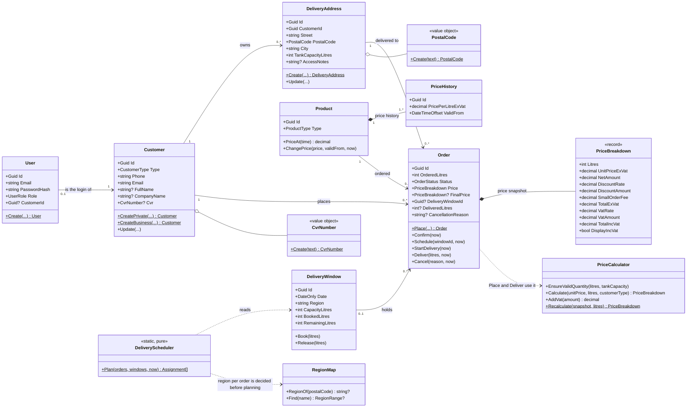
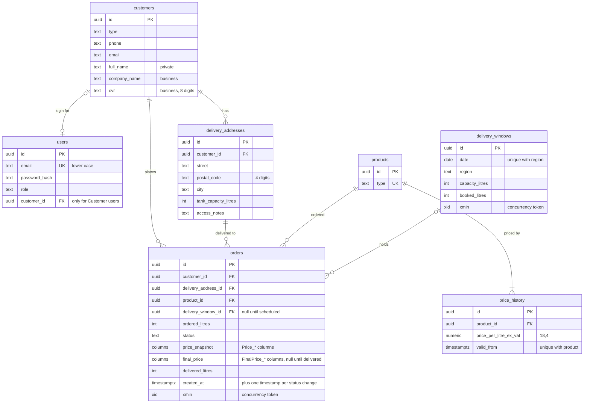

# Domain model

Three views of the same system: the **domain classes**, the **layer classes** (who talks to whom), and the **database tables**.

## 1. Domain classes

Reading notes:

- `Order` and `DeliveryWindow` are the two classes with real behaviour. Everything that changes an order goes through its methods, never by setting `Status` directly.
- `PriceBreakdown` is an immutable record stored on the order at order time. It never changes. The final price after delivery is a second copy (`FinalPrice`).
- Enums: `UserRole` (Customer, Dispatcher, Admin), `CustomerType` (Private, Business), `ProductType` (HeatingOil, Diesel, Hvo), `OrderStatus` (Pending, Confirmed, Scheduled, OutForDelivery, Delivered, Cancelled).

## 2. Layer classes: use cases, ports and adapters

```mermaid
classDiagram
    direction TB

    class AuthService
    class CustomerService
    class ProductService
    class OrderService
    class DispatchService
    class SchedulingService

    class IUserRepository { <<interface>> }
    class ICustomerRepository { <<interface>> }
    class IAddressRepository { <<interface>> }
    class IProductRepository { <<interface>> }
    class IOrderRepository { <<interface>> }
    class IDeliveryWindowRepository { <<interface>> }
    class IUnitOfWork { <<interface>> }
    class IPasswordService { <<interface>> }
    class ITokenService { <<interface>> }

    class FuelFlowDbContext {
        SaveChangesAsync()
        DiscardChanges()
    }
    class UserRepository
    class CustomerRepository
    class AddressRepository
    class ProductRepository
    class OrderRepository
    class DeliveryWindowRepository
    class PasswordService
    class JwtTokenService

    AuthService --> IUserRepository
    AuthService --> ICustomerRepository
    AuthService --> IPasswordService
    AuthService --> ITokenService
    CustomerService --> ICustomerRepository
    CustomerService --> IAddressRepository
    ProductService --> IProductRepository
    OrderService --> IOrderRepository
    OrderService --> IAddressRepository
    OrderService --> IProductRepository
    OrderService --> IDeliveryWindowRepository
    DispatchService --> IOrderRepository
    DispatchService --> IDeliveryWindowRepository
    SchedulingService --> IOrderRepository
    SchedulingService --> IDeliveryWindowRepository

    AuthService --> IUnitOfWork
    OrderService --> IUnitOfWork
    DispatchService --> IUnitOfWork
    SchedulingService --> IUnitOfWork

    UserRepository ..|> IUserRepository
    CustomerRepository ..|> ICustomerRepository
    AddressRepository ..|> IAddressRepository
    ProductRepository ..|> IProductRepository
    OrderRepository ..|> IOrderRepository
    DeliveryWindowRepository ..|> IDeliveryWindowRepository
    FuelFlowDbContext ..|> IUnitOfWork
    PasswordService ..|> IPasswordService
    JwtTokenService ..|> ITokenService

    UserRepository --> FuelFlowDbContext
    OrderRepository --> FuelFlowDbContext
```

The top row is the Application layer, the interfaces are the ports it defines, and the bottom rows are the Infrastructure adapters. (Only some adapters are drawn pointing at the DbContext, to keep the picture readable: all repositories use it.)

`FuelFlowDbContext` plays the "unit of work" role: repositories only *add* or *find*; `SaveChangesAsync` commits everything in one transaction. It also translates database errors into application exceptions (concurrency conflict, duplicate email, duplicate window).

## 3. Database tables

Choices behind the tables:

- **Price snapshot as columns on `orders`.** EF Core "complex types" store the `PriceBreakdown` as `Price_NetAmount`, `Price_VatAmount` and so on, instead of a separate table. One row read gives the whole order.
- **`price_history` is append-only** (apart from replacing prices that are scheduled but not yet in force). Old orders do not depend on it, because they carry their own snapshot.
- **Foreign keys from orders are `RESTRICT`.** A customer, address, product or window with orders cannot be deleted by accident.
- **`xmin` is a system column in PostgreSQL** that changes on every update of a row. EF Core adds `WHERE xmin = @old` to updates, so a second writer on the same row gets "0 rows updated" and the app returns 409.
- Region is **not** stored on addresses. It is worked out from the postal code and the configured ranges, so changing the region setup needs no data migration. Windows store the region name, so renaming a region in configuration also means updating existing windows.
