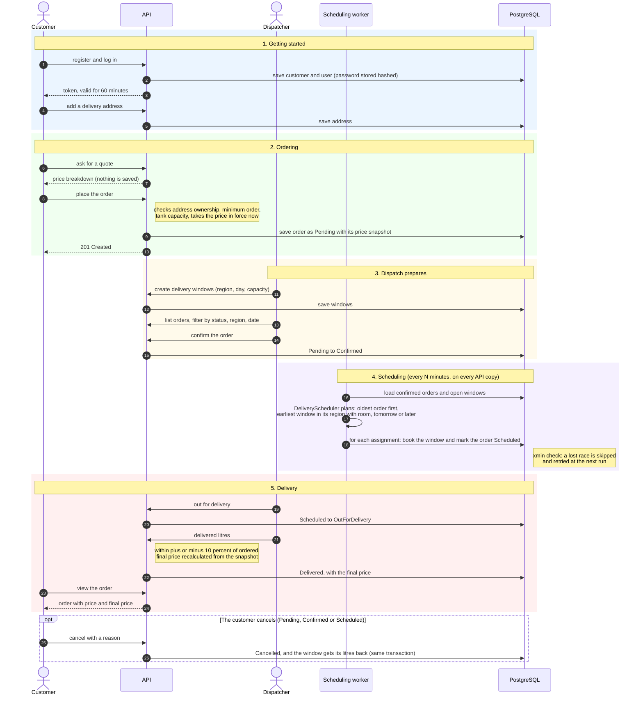
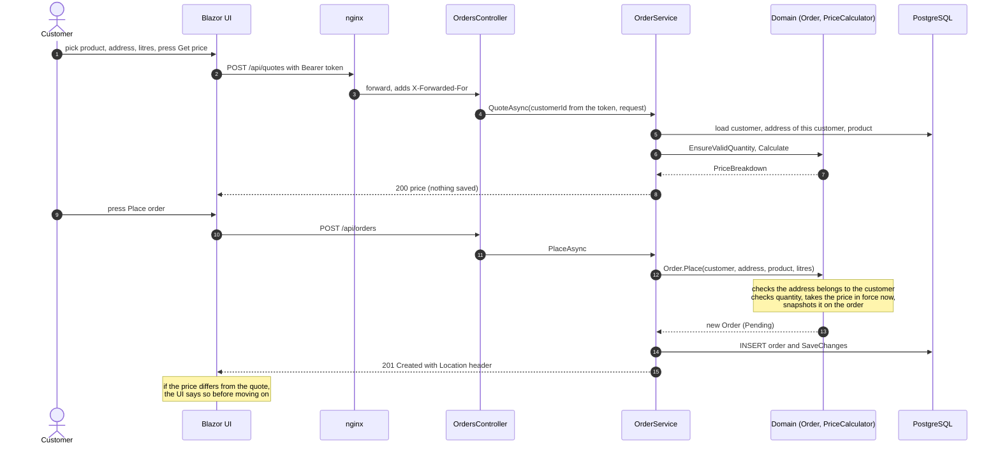
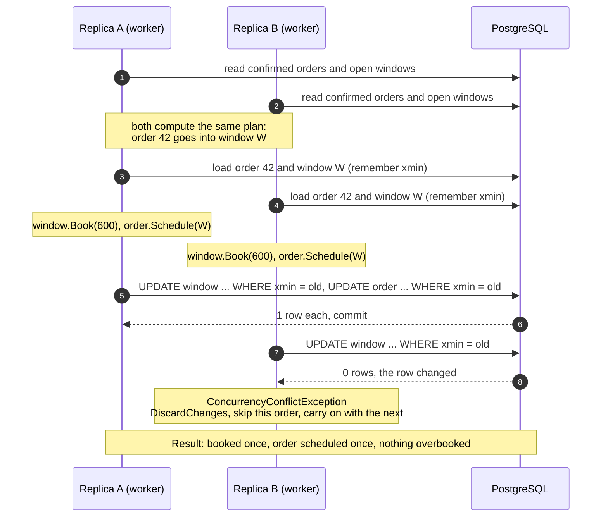
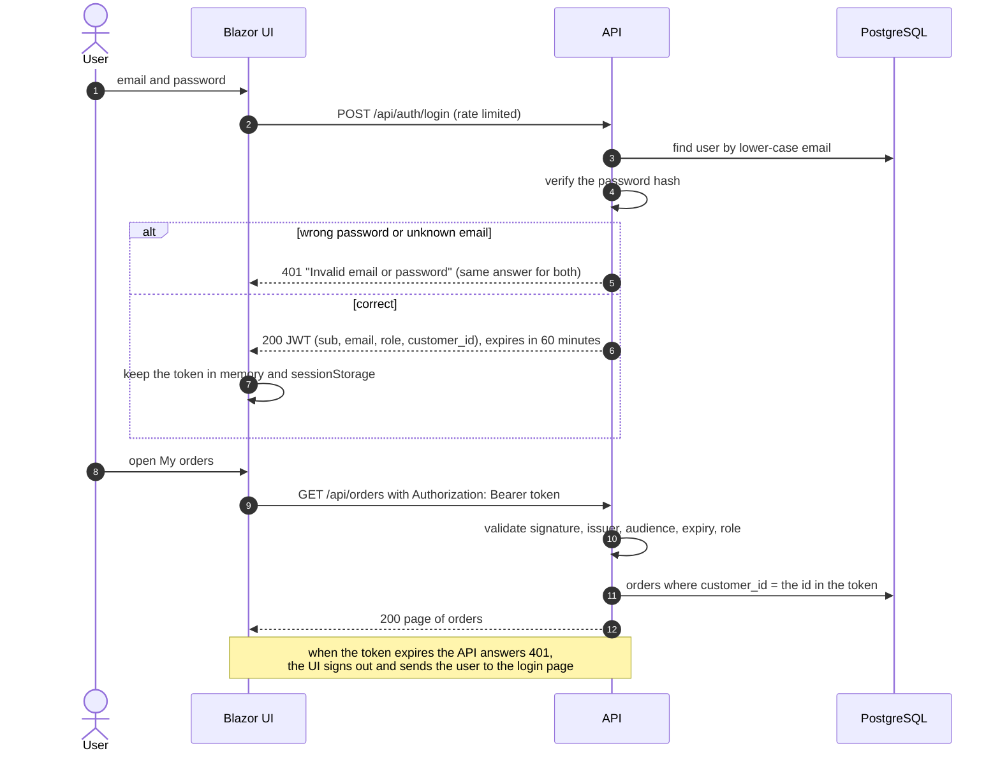
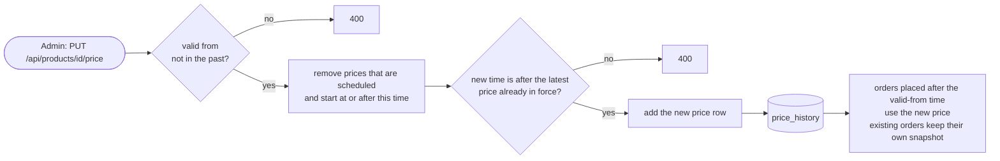

# Flows

How work moves between people and parts of the system. The first diagram is a swimlane view of a whole order. The others zoom in on the three trickiest moments.

## 1. An order from start to finish (swimlanes)

Each vertical line is a **lane**: a person or a part of the system. Time runs from top to bottom, and the colours group the phases.

## 2. Placing an order

## 3. Two replicas schedule at the same time

Every API copy runs the worker, so two copies can plan the same order in the same moment. The database decides who wins.

The same check protects the dispatcher screen: if a customer cancels while a dispatcher confirms the same order, the second save fails and the user sees a **409** "changed by someone else".

## 4. Log in and call the API

## 5. Price changes

