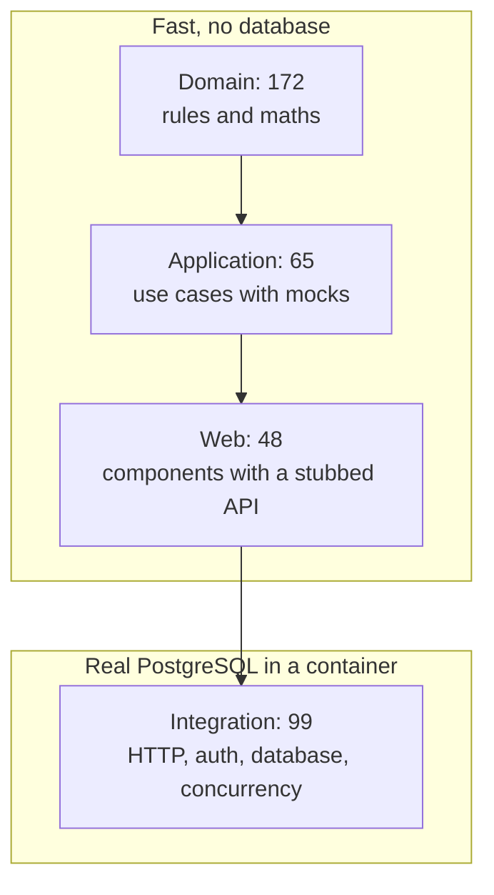
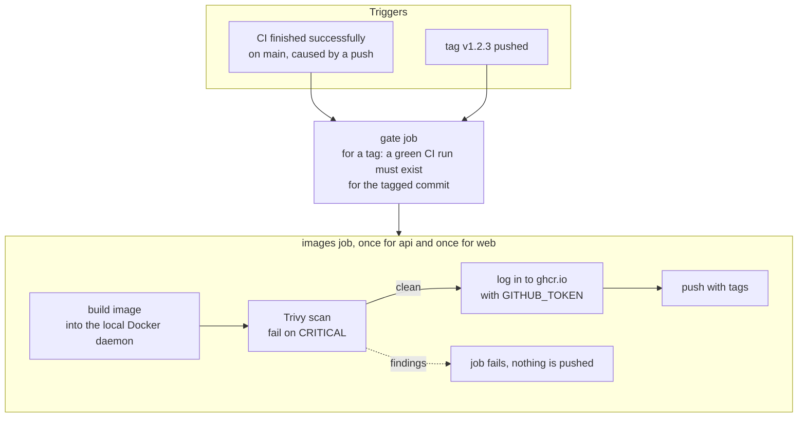

# Testing and delivery

## 1. Test strategy

| Test project | What it tests | Speed | Count |
|---|---|---|---|
| `FuelFlow.Domain.UnitTests` | Pricing rules and boundaries, rounding, the order state machine (every status against every action), validation (CVR, postal code, quantity), the delivery scheduler | Under a second | 172 |
| `FuelFlow.Application.UnitTests` | Use case services with mocked repositories (NSubstitute), validators, scheduling service including lost races | Under a second | 65 |
| `FuelFlow.Web.UnitTests` | The Blazor UI with bUnit: JWT parsing, API client errors, session, pages, startup wiring. HTTP is stubbed. | About a second | 48 |
| `FuelFlow.Api.IntegrationTests` | The real API against real PostgreSQL (Testcontainers): auth, roles, ownership, every endpoint, concurrency, the worker, health | About 15 seconds | 99 |

Total: **384 tests**.



### What the integration tests cover

- **Auth:** register, login, wrong password, 401 without a token, 403 for the wrong role, expired token, tampered token, rate limit.
- **Ownership:** customer A cannot read, change or cancel customer B's order or address (404, and the body does not leak the id).
- **Full happy path:** place, confirm, schedule, out for delivery, deliver, then check the recalculated final totals.
- **Errors:** invalid status change returns 409 with ProblemDetails. Validation errors return 400 with a field list.
- **Concurrency:** two parallel bookings into a nearly full window (only one wins), several scheduler runs at once, a cancel racing a confirm.
- **Startup:** missing connection string, short JWT key, bad region setup all stop the app.
- **Health:** live, ready, and ready returning 503 when the database is unreachable.

### Conventions

- Names follow `MethodName_Scenario_ExpectedResult`.
- `[Theory]` with data for boundaries (499 and 500 litres, 4,999 and 5,000 litres, plus or minus 10 percent).
- Assertions use Shouldly. Mocks use NSubstitute. No FluentAssertions.
- Time is never read from the system clock. See [design decision 22](design-decisions.md#22-controllable-time-in-tests).
- A test that finds a bug is kept as a regression test (for example the integer overflow in the 10 percent check and the paging parameter that was silently ignored).

### Running the tests

```bash
dotnet test                                   # everything
dotnet test --project tests/FuelFlow.Domain.UnitTests   # one project
```

Integration tests need a container engine. With Podman:

```bash
systemctl --user enable --now podman.socket
export DOCKER_HOST=unix://$XDG_RUNTIME_DIR/podman/podman.sock
```

## 2. Continuous integration (`ci.yml`)

Runs on every pull request and every push to `main`.

```mermaid
flowchart LR
    t(["pull request or push to main"]) --> co["checkout"]
    co --> sd["setup .NET 10<br/>NuGet cache"]
    sd --> rs["restore"]
    rs --> fm["dotnet format<br/>--verify-no-changes"]
    fm --> bd["build in Release<br/>warnings are errors"]
    bd --> ut["unit tests<br/>Domain, Application, Web<br/>with coverage"]
    ut --> it["integration tests<br/>Testcontainers + PostgreSQL"]
    it --> cv["coverage summary in the job summary"]
    cv --> up["upload test results"]
```



## 3. Continuous delivery (`cd.yml`)



- **Why the gate:** a tag push has no CI run of its own. The gate checks CI already passed for that exact commit.
- **Only pushes:** the `workflow_run` trigger ignores CI runs caused by pull requests, so code from a fork can never reach a job that can push images.
- **Permissions:** nothing by default. The gate gets `actions: read`. The image job gets `contents: read` and `packages: write`.

### Image tags

| Event | Tags pushed |
|---|---|
| Push to `main` (after CI) | the full commit SHA |
| Tag `v1.2.3` | the commit SHA, `1.2.3`, `1.2`, and `latest` |

Images are named `ghcr.io/<owner>/<repo>/api` and `ghcr.io/<owner>/<repo>/web`, in lower case.

To make a release: tag a commit that passed CI (`git tag v1.2.3 && git push origin v1.2.3`).

### Dependabot

Weekly pull requests for NuGet (minor and patch grouped), Docker base images and GitHub Actions.

## 4. Docker images

| | API | Web |
|---|---|---|
| Build | .NET SDK 10, restore as its own cached layer, `dotnet publish` | .NET SDK 10, `dotnet publish` of the Blazor app |
| Runtime | `aspnet:10.0-noble-chiseled`: no shell, no package manager | `nginx-unprivileged:1.30-alpine`, packages upgraded during the build |
| User | non-root (uid 1654) | non-root (uid 101) |
| Port | 8080 | 8080 |
| Size | about 136 MB | about 71 MB |
| Contents | no development settings file | static files and an nginx config template |

Both are built from the repository root:

```bash
docker build -f src/FuelFlow.Api/Dockerfile .
docker build -f src/FuelFlow.Web/Dockerfile .
```

## 5. Kubernetes readiness

No manifests yet, but the app is built for it: stateless API, configuration from environment variables, logs to stdout, `/health/live` and `/health/ready` for probes, non-root containers, and a safe way to run several replicas (concurrency checks, no local state).

Set `GSS Encryption Mode=Disable` in the PostgreSQL connection string: the chiseled image has no Kerberos libraries and Npgsql would otherwise log a harmless but noisy error at startup.
